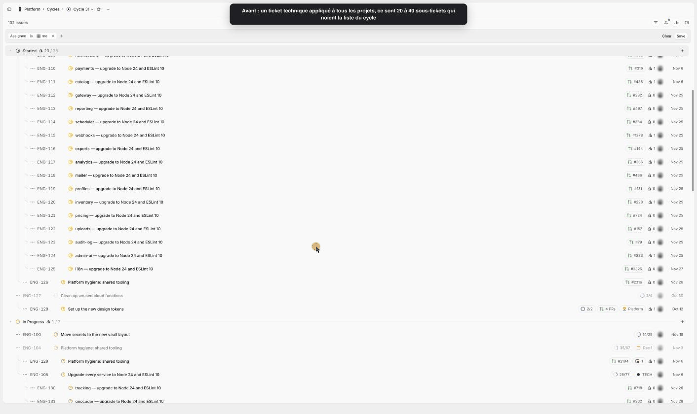

# Linear · Show sub-issues extended

Extension Chrome pour [Linear](https://linear.app) qui complète l'option **Show sub-issues** des vues en liste : replier les sous-tickets sous leur parent, voir combien il y en a, et distinguer chaque niveau de l'arbre par une couleur.



**[⬇ Télécharger l'extension](https://github.com/ndy913/show-sub-issues-extended/releases/latest/download/show-sub-issues-extended.zip)**, puis suivre l'[installation](#installation).

## Le problème

Avec **Show sub-issues** et **Nested sub-issues** activés, Linear affiche les sous-tickets sous leur parent. Mais un ticket technique appliqué à tous les projets compte vite 20 à 40 sous-tickets, qui noient la liste du cycle. Et en vue liste, Linear ne permet pas de replier les sous-tickets d'un parent.

## Ce que fait l'extension

- **Un chevron devant le statut de chaque ticket parent** replie ou déplie ses sous-tickets. La ligne cliquée reste à sa place à l'écran.
- **Le clic droit sur un ticket parent** propose aussi « Replier les sous-tickets » ou « Déplier les sous-tickets ».
- **Alt + clic sur un chevron** replie ou déplie tous les parents de la liste, y compris ceux qui ne sont pas à l'écran.
- **Une pastille après le titre** donne le nombre de sous-tickets du parent dans la vue (« 20 », ou « 20 masqués » une fois replié).
- **Un fond pastel par niveau** de l'arbre, qui part du trait de l'arbre et change de teinte à chaque niveau.
- Les tickets repliés le restent après un rechargement, et d'un onglet à l'autre.

## Réglages

Dans la popup de l'extension (clic sur son icône). Les réglages ne s'affichent que sur une liste de tickets qui montre les sous-tickets en arbre, donc avec **Show sub-issues** cochée et **Nested sub-issues** sur autre chose que Hide (Display options de Linear, Shift+V). Sinon, la popup le dit et propose un bouton **Afficher les sous-tickets en arbre**, qui règle ces deux options sur la vue ouverte.

| Réglage | Effet |
| --- | --- |
| Extension active | Coupe tout d'un coup pour revoir les listes sans chevrons, pastilles ni couleurs. |
| Repli des sous-tickets | Chevron, entrée du clic droit et pastille. Avec les boutons **Tout replier** et **Tout déplier**, qui agissent sur la liste ouverte. |
| Couleur par niveau | Fond pastel par niveau. Trois palettes neutres (Lavande, Ardoise, Sable) ou une palette personnalisée, avec un sélecteur de couleur par niveau. |
| Intensité du fond | Opacité du fond du premier niveau. |
| Écart entre niveaux | De combien le fond se renforce à chaque niveau. |

Les palettes évitent volontairement le vert, l'orange, le bleu et le rouge, qui ont déjà un sens dans Linear (statuts, priorités).

## Installation

L'extension n'est pas sur le Chrome Web Store : elle s'installe en mode développeur, en deux minutes. Deux façons de faire, au choix : avec le **zip** (le plus simple), ou avec **git** (le plus simple à mettre à jour).

Dans les deux cas, Chrome 111 ou plus récent est nécessaire. Ça marche aussi dans les navigateurs basés sur Chrome (Brave, Edge, Arc, Vivaldi), avec leur propre page d'extensions.

### Avec le zip

**Installer**

1. **Télécharger le zip** : [show-sub-issues-extended.zip](https://github.com/ndy913/show-sub-issues-extended/releases/latest/download/show-sub-issues-extended.zip). Ce lien donne toujours la dernière version ; les précédentes sont dans les [releases](https://github.com/ndy913/show-sub-issues-extended/releases).
2. Le **décompresser**. On obtient un dossier `show-sub-issues-extended`. Le ranger dans un endroit où il restera, par exemple `Documents` : Chrome charge l'extension depuis ce dossier, le supprimer supprime l'extension.
3. Ouvrir **`chrome://extensions`** (à coller dans la barre d'adresse) et activer **Mode développeur**, en haut à droite.
4. Cliquer sur **Charger l'extension non empaquetée** et choisir le dossier décompressé.
5. Recharger l'onglet Linear. Pour l'avoir sous la main, épingler l'extension depuis l'icône puzzle de la barre d'outils.

**Mettre à jour**

1. Retélécharger le zip avec [le même lien](https://github.com/ndy913/show-sub-issues-extended/releases/latest/download/show-sub-issues-extended.zip) et le décompresser.
2. Remplacer le contenu du dossier installé par celui du nouveau dossier. Le dossier doit garder le même emplacement : c'est celui que Chrome connaît.
3. Dans `chrome://extensions`, cliquer sur **↻** sur la carte de l'extension.
4. Recharger l'onglet Linear.

### Avec git

**Installer**

1. Cloner le dépôt là où il restera, par exemple dans `Documents` :
   ```bash
   git clone https://github.com/ndy913/show-sub-issues-extended.git
   ```
2. Ouvrir **`chrome://extensions`** et activer **Mode développeur**, en haut à droite.
3. Cliquer sur **Charger l'extension non empaquetée** et choisir le dossier `show-sub-issues-extended` cloné.
4. Recharger l'onglet Linear.

**Mettre à jour**

1. Récupérer la dernière version (la branche `main` contient toujours la dernière version publiée) :
   ```bash
   cd show-sub-issues-extended
   git pull
   ```
2. Dans `chrome://extensions`, cliquer sur **↻** sur la carte de l'extension.
3. Recharger l'onglet Linear.

### Bon à savoir

- **Quelle version est installée** : elle est affichée sur la carte de l'extension, dans `chrome://extensions`. La dernière publiée est en haut de la page des [releases](https://github.com/ndy913/show-sub-issues-extended/releases).
- **Les réglages et les tickets repliés sont conservés** lors d'une mise à jour.
- **Après une mise à jour, recharger les onglets Linear déjà ouverts** : tant qu'ils ne sont pas rechargés, l'extension n'y agit plus, et sa popup propose un bouton pour le faire.

## Confidentialité

- L'extension ne s'active que sur `https://linear.app/*`. Elle ne demande que l'accès à ce site et la permission `storage`.
- Elle n'envoie rien sur le réseau. Les réglages sont dans `chrome.storage.local`, et la liste des tickets repliés dans le `localStorage` de linear.app.
- Le détail est dans [PRIVACY.md](PRIVACY.md).

## Comment ça marche, et ses limites

La liste de Linear est virtualisée : masquer des lignes dans le DOM laisserait des trous. L'extension agit donc sur les données de la liste, qu'elle lit dans les fibers React du composant de liste : replier un parent vide ses `subItems` et efface le cache de hauteurs `nestedHeights`, puis la liste est redessinée. Le détail est en commentaire dans [`content.js`](content.js).

Ça repose sur le fonctionnement interne de Linear, qui peut changer sans prévenir. Si Linear modifie ce composant, l'extension peut cesser de fonctionner. Dans ce cas, les chevrons n'apparaissent plus mais Linear reste utilisable normalement.

Le bouton **Afficher les sous-tickets en arbre** repère les libellés anglais du panneau Display options : avec Linear dans une autre langue, il ne fait rien, et il faut régler les deux options à la main.

## Fichiers

| Fichier | Rôle |
| --- | --- |
| `manifest.json` | Déclaration de l'extension (Manifest V3). |
| `content.js` | Script exécuté dans la page Linear : repli, chevrons, pastilles, menu clic droit. |
| `content.css` | Styles du chevron, de la pastille et des couleurs par niveau. |
| `bridge.js`, `options.js` | Relais entre la popup et la page : réglages et actions. |
| `popup.html`, `popup.js` | La popup de réglages. |
| `icons/` | L'icône, et sa source `icon.svg`. |
| `scripts/build-zip.sh` | Construit le zip joint à chaque release (`dist/show-sub-issues-extended.zip`). |
| `PRIVACY.md` | Ce que l'extension fait, et ne fait pas, des données. |

## Licence

[MIT](LICENSE) : libre d'utilisation, de copie et de modification, en gardant la mention de copyright.
